# Отчет по практической работе №2: Регулярные выражения, грамматики и языки

* **Дисциплина:** Теория автоматов, языков и вычислений
* **Тема:** Регулярные выражения, регулярные грамматики, лемма о разрастании регулярных языков
* **Вариант:** № 12
* **Выполнил:** Ковалец П. А. КИ24-16/1б
* **Проверил:** Кузнецов А. С.

---

**Цель:** изучение способов задания регулярных языков с помощью регулярных выражений и регулярных грамматик, их взаимного преобразования с конечными автоматами в среде JFLAP, а также доказательство нерегулярности языков с помощью леммы о разрастании.

**Постановка задачи (Вариант 12):**
1. **Часть 1:** построить РВ для языка L12 над алфавитом {a, b, c}, строки которого не содержат «отрезков» (подстрок) из символов a длиной больше 2. Привести обобщенный граф переходов, эквивалентный КА и пошаговое выполнение преобразований.
2. **Часть 2:** построить регулярную грамматику для того же языка L12. Привести эквивалентный КА и РВ, а также пошаговое выполнение преобразований.
3. **Часть 3:** доказать принадлежность или непринадлежность к классу РЯ языка L38 = {a<sup>n</sup>ba<sup>n</sup> : n ≥ 1}.

---

## Часть 1. Регулярное выражение для L12

### Анализ языка
Строка запрещена тогда и только тогда, когда содержит подстроку `aaa`. Значит, автомату достаточно помнить, сколько символов a подряд стоит в конце уже прочитанной части: 0, 1, 2 или «уже было 3». Язык конечно-автоматный, следовательно, регулярный, и РВ для него существует.

### Эквивалентный КА (ДКА)
ДКА задается кортежем $M = (Q, \Sigma, \delta, q_0, F)$:
* $Q = \{q_0, q_1, q_2, q_3\}$, $\Sigma = \{a, b, c\}$, начальное состояние $q_0$;
* $F = \{q_0, q_1, q_2\}$;
* $q_3$ - ловушка (встретилась подстрока aaa).

| Состояние | $a$ | $b$ | $c$ | Смысл |
| :---: | :---: | :---: | :---: | :--- |
| $\to\ast q_0$ | $q_1$ | $q_0$ | $q_0$ | в конце 0 символов a подряд |
| $\ast q_1$ | $q_2$ | $q_0$ | $q_0$ | в конце ровно одна a |
| $\ast q_2$ | $q_3$ | $q_0$ | $q_0$ | в конце ровно две a |
| $q_3$ | $q_3$ | $q_3$ | $q_3$ | ловушка |

Файлы: `dfa_full.jff` (полный ДКА с ловушкой), `dfa.jff` (без ловушки, используется для преобразований). Ловушку удаляем, т.к. из нее недостижимо ни одно заключительное состояние, и на язык она не влияет; при исключении она дала бы только ∅-метки.

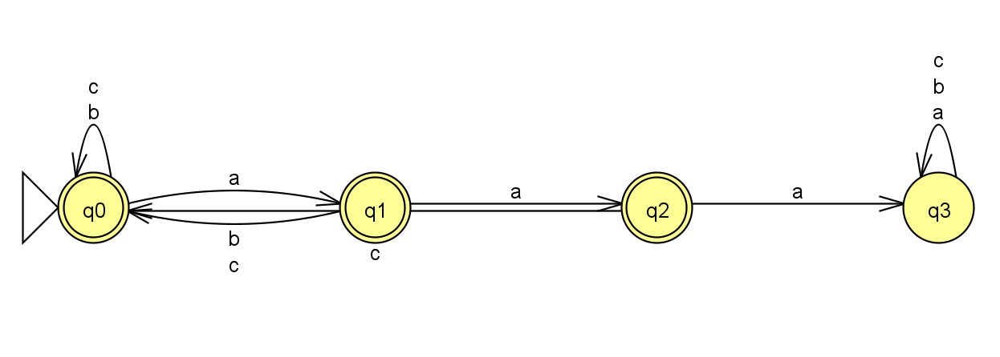

### Преобразование КА → РВ (Convert → Convert FA to RE)

**Шаг 1. Единственное заключительное состояние.** Заключительных состояний три, и одно из них совпадает с начальным. Добавляем новое состояние $q_f$ и λ-переходы $q_0 \to q_f$, $q_1 \to q_f$, $q_2 \to q_f$; состояния $q_0, q_1, q_2$ перестают быть заключительными.

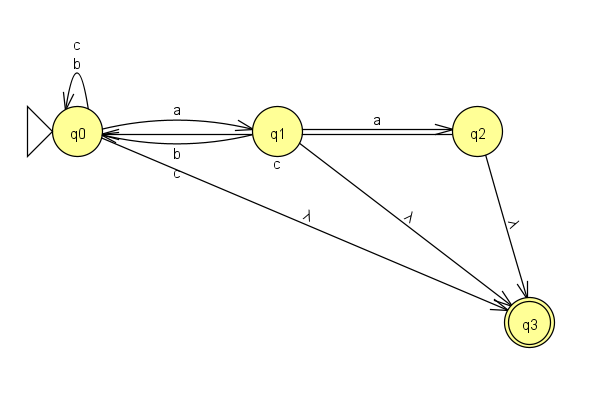

**Шаг 2. Слияние параллельных переходов (Transition Collapser).** Пары дуг по b и c сливаются в одну дугу `b+c`: петля $q_0 \to q_0$, а также $q_1 \to q_0$ и $q_2 \to q_0$.

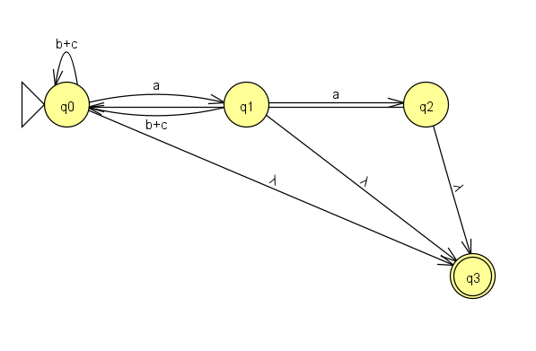

**Шаг 3. Пустые переходы.** Для пар состояний без дуги создаются ∅-переходы (8 штук): $q_0\to q_2$, $q_1\to q_1$, $q_2\to q_1$, $q_2\to q_2$, $q_f\to q_0$, $q_f\to q_1$, $q_f\to q_2$, $q_f\to q_f$.

Получен обобщенный граф переходов (GTG). Матрица меток $r_{ij}$:

| из \ в | $q_0$ | $q_1$ | $q_2$ | $q_f$ |
| :---: | :---: | :---: | :---: | :---: |
| $q_0$ | b+c | a | ∅ | λ |
| $q_1$ | b+c | ∅ | a | λ |
| $q_2$ | b+c | ∅ | ∅ | λ |
| $q_f$ | ∅ | ∅ | ∅ | ∅ |

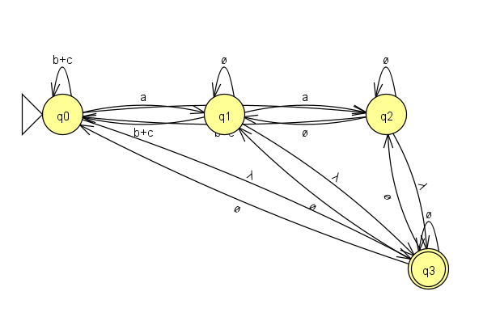

**Шаг 4. Исключение $q_2$ (State Collapser).** Формула $r_{ij} := r_{ij} + r_{i2}\, r_{22}^{*}\, r_{2j}$, где $r_{22}=\emptyset$, $\emptyset^*=\lambda$. В $q_2$ входит только дуга из $q_1$ (метка a), поэтому меняются только метки из $q_1$:
* $r_{10} = (b+c) + a(b+c)$
* $r_{1f} = \lambda + a\lambda = \lambda + a$
* $r_{11} = \emptyset + a\,\emptyset = \emptyset$ (без изменений)

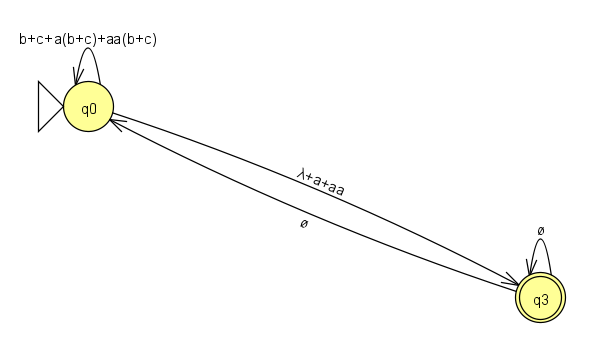

**Шаг 5. Исключение $q_1$.** В $q_1$ входит только дуга из $q_0$ (метка a), $r_{11}=\emptyset$:
* $r_{00} = (b+c) + a\big((b+c) + a(b+c)\big)$
* $r_{0f} = \lambda + a(\lambda + a)$

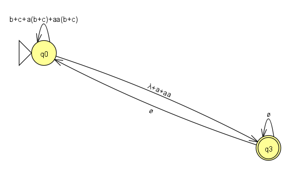

GTG после удаления $q_1$ и $q_2$ (в JFLAP новое заключительное состояние названо $q_3$, в отчете это $q_f$):


**Шаг 6. Итоговое РВ.** Остались $q_0$ (начальное) и $q_f$ (заключительное), $r_{f0} = r_{ff} = \emptyset$, поэтому формула $(r_{00}^* r_{0f} r_{ff}^* r_{f0})^* r_{00}^* r_{0f} r_{ff}^*$ сводится к $r_{00}^*\, r_{0f}$. JFLAP после удаления состояний показывает метки уже с раскрытыми скобками: $r_{00} = b+c+a(b+c)+aa(b+c)$, $r_{0f} = \lambda+a+aa$ (скриншот 7). Итоговое РВ:

$$\big((b+c) + a((b+c) + a(b+c))\big)^*\,(\lambda + a(\lambda + a))$$

Раскрыв скобки по дистрибутивности, получаем компактную форму:

$$\boxed{\big((\lambda + a + aa)(b+c)\big)^*\,(\lambda + a + aa)}$$

Смысл: строка разбивается на блоки «не более двух a, затем b или c», а в конце допускается хвост из не более двух a. Три a подряд получить невозможно, т.к. после каждой группы a обязательно идет b или c.


> JFLAP может показать РВ в другой, но эквивалентной записи (зависит от порядка удаления состояний). Эквивалентность обеих форм проверена программно (`check.py`).

### Проверка: РВ → НКА (Convert → Convert to NFA)
Файл `regex.jff` содержит РВ `((!+a+aa)(b+c))*(!+a+aa)` (в JFLAP `!` означает λ). Кнопкой Do All строится ε-НКА; на нем Multiple Run дает те же результаты, что и ДКА.

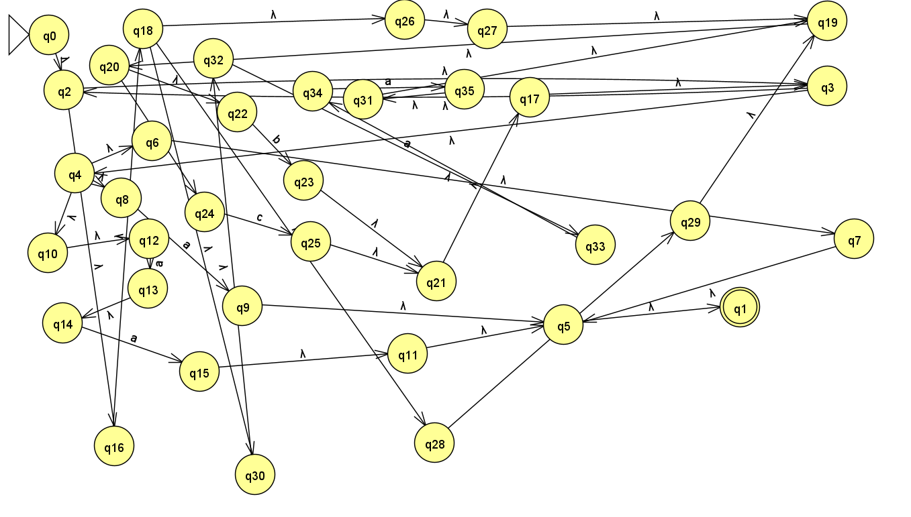
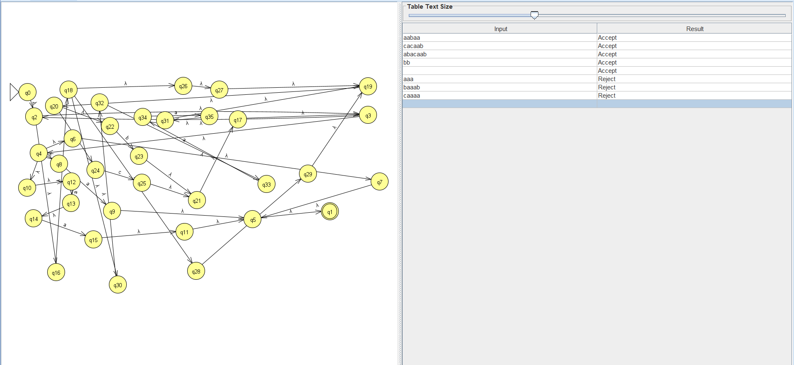

---

## Часть 2. Регулярная грамматика для L12

### Преобразование ДКА → ПЛГ (Convert → Convert to Grammar)
По теореме 5.2 каждое состояние становится нетерминалом ($q_0 \to S$, $q_1 \to A$, $q_2 \to B$), каждый переход $\delta(q_i, x) = q_k$ дает продукцию $q_i \to x\,q_k$, каждое заключительное состояние дает продукцию $q_i \to \lambda$. Ловушка $q_3$ не используется: из нее не выводится ни одна терминальная строка.

$G = (\{a,b,c\}, \{S, A, B\}, P, S)$, где $P$:

| Переход ДКА | Продукция |
| :---: | :---: |
| $\delta(q_0,a)=q_1,\ \delta(q_0,b)=\delta(q_0,c)=q_0,\ q_0\in F$ | $S \to aA \mid bS \mid cS \mid \lambda$ |
| $\delta(q_1,a)=q_2,\ \delta(q_1,b)=\delta(q_1,c)=q_0,\ q_1\in F$ | $A \to aB \mid bS \mid cS \mid \lambda$ |
| $\delta(q_2,b)=\delta(q_2,c)=q_0,\ q_2\in F$ | $B \to bS \mid cS \mid \lambda$ |

Все продукции имеют вид $X \to xY$ или $X \to \lambda$, значит грамматика праволинейная, т.е. регулярная. Смысл нетерминалов: $S$ - «в конце нет a», $A$ - «одна a», $B$ - «две a»; у $B$ нет продукции с a, поэтому третья a подряд не выводится.

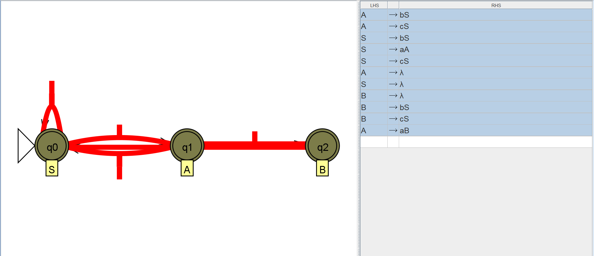

**Примеры выводов:**
* `aaba`: S ⇒ aA ⇒ aaB ⇒ aabS ⇒ aabaA ⇒ aaba
* `caab`: S ⇒ cS ⇒ caA ⇒ caaB ⇒ caabS ⇒ caab
* `aaa`: S ⇒ aA ⇒ aaB, дальше продукции с a нет, вывода не существует.

Файл: `grammar.jff`. Проверка в JFLAP: Input → Brute Force Parse.

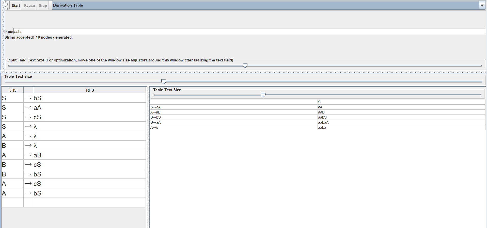

### Эквивалентный КА (Convert → Convert Right-Linear Grammar to FA)
По теореме 5.1 нетерминалы S, A, B становятся состояниями, продукция $X \to xY$ дает дугу X→Y по x. Для продукций $X \to \lambda$ JFLAP создает отдельное заключительное состояние $V_f$ (на скриншоте $q_3$) и λ-переходы в него из S, A и B. Номера состояний JFLAP присваивает сам: S = $q_2$, A = $q_0$, B = $q_1$.

Получается НКА с λ-переходами. Если убрать $V_f$ и сделать S, A, B заключительными, он совпадает с ДКА из части 1 (без ловушки), поэтому язык тот же.

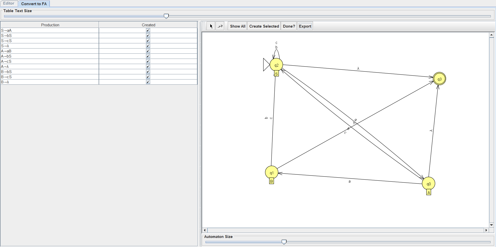

### Эквивалентное РВ
Полученный КА преобразуется в РВ точно так же, как в части 1 (шаги 1–6):

$$\big((\lambda + a + aa)(b+c)\big)^*\,(\lambda + a + aa)$$

---

## Часть 3. Язык L38 = {a<sup>n</sup>ba<sup>n</sup> : n ≥ 1}

**Утверждение:** L38 не является регулярным.

**Доказательство (от противного, лемма о разрастании).**
1. Предположим, что L38 регулярен. Тогда по лемме существует константа $p \ge 1$ такая, что любая строка $w \in L38$, $|w| \ge p$, разбивается как $w = xyz$, где $y \ne \varepsilon$, $|xy| \le p$ и $xy^kz \in L38$ для всех $k \ge 0$.
2. Выберем $w = a^p b a^p$. Тогда $w \in L38$ (n = p ≥ 1) и $|w| = 2p + 1 \ge p$.
3. Рассмотрим **произвольное** разбиение $w = xyz$ с $|xy| \le p$, $y \ne \varepsilon$. Первые $p$ символов $w$ все равны a, поэтому $xy$ целиком лежит в первом блоке a: $x = a^s$, $y = a^t$, $z = a^{p-s-t} b a^p$, где $t \ge 1$, $s + t \le p$.
4. Возьмем $k = 0$: $xy^0z = xz = a^{p-t} b a^p$. Так как $t \ge 1$, число a слева $p - t$ не равно числу a справа $p$, значит $xz \notin L38$. (Для $k = 2$ аналогично: $a^{p+t} b a^p \notin L38$.)
5. Получено противоречие с пунктом 3 леммы. Следовательно, L38 не регулярен. ∎

Интуиция: чтобы проверить равенство числа a слева и справа, автомат должен «помнить» сколь угодно большое n, а у конечного автомата конечная память.

В `check.py` для $p = 3$ перебраны все 6 допустимых разбиений строки `aaabaaa`; для каждого $xy^0z \notin L38$.

---

## Программная проверка
`check.py` реализует ДКА (табличная модель, как в работе №1), РВ и грамматику и сравнивает их с определением языка («нет подстроки aaa») на всех 9841 строках над {a, b, c} длины до 8: расхождений нет.

```
python3 check.py
```

## Выводы
Для языка L12 построены эквивалентные ДКА, регулярное выражение $((\lambda+a+aa)(b+c))^*(\lambda+a+aa)$ и праволинейная грамматика; преобразования между ними выполнены по алгоритмам исключения состояний (КА → РВ) и теорем 5.1–5.2 (КА ↔ ПЛГ) и проверены в JFLAP и программно. С помощью леммы о разрастании доказано, что язык L38 = {a<sup>n</sup>ba<sup>n</sup>} не является регулярным.
