# Отчет по практической работе №2: Регулярные выражения, грамматики и языки

* **Дисциплина:** Теория автоматов, языков и вычислений
* **Тема:** Регулярные выражения, регулярные грамматики, лемма о разрастании регулярных языков
* **Вариант:** № 12
* **Выполнил:** Ковалец П. А. КИ24-16/1б
* **Проверил:** Кузнецов А. С.

---

**Цель:** изучение способов задания регулярных языков с помощью регулярных выражений и регулярных грамматик, их преобразования в конечные автоматы и обратно в среде JFLAP, а также доказательство нерегулярности языков с помощью леммы о разрастании.

**Постановка задачи (Вариант 12):**
1. **Часть 1:** с использованием JFLAP построить РВ для языка L12 над алфавитом {a, b, c}, строки которого не содержат «отрезков» (подстрок) из символов a длиной больше 2. Привести обобщенный граф переходов и эквивалентный КА, а также пошаговое выполнение преобразований.
2. **Часть 2:** с использованием JFLAP построить регулярную грамматику для языка L12. Привести эквивалентный КА и РВ, а также пошаговое выполнение преобразований.
3. **Часть 3:** доказать принадлежность или непринадлежность к классу РЯ языка L38 = {a<sup>n</sup>ba<sup>n</sup> : n ≥ 1}.

**Файлы JFLAP:** `regex.jff` (РВ, часть 1), `grammar.jff` (РГ, часть 2).

---

## Часть 1. Регулярное выражение для L12

### Построение РВ
Разобьем произвольную строку $w \in \{a,b,c\}^*$ на части, разрезая ее сразу после каждого символа b или c:

$$w = u_1 u_2 \dots u_k\, v,\qquad u_i = a^{m_i} x_i,\ x_i \in \{b, c\},\qquad v = a^{m}.$$

Каждая часть $u_i$ - это группа из $m_i$ символов a, за которой стоит b или c, а $v$ - хвост, состоящий только из a. Подряд идущие символы a в $w$ - это в точности группы $a^{m_i}$ и хвост $a^m$, поэтому

$$w \in L12 \iff m_1, \dots, m_k, m \le 2.$$

Группа «не более двух a» описывается выражением $\lambda + a + aa$, символ «b или c» - выражением $b + c$. Части $u_i$ повторяются произвольное число раз (итерация), хвост $v$ встречается один раз. Получаем РВ:

$$\boxed{R = \big((\lambda + a + aa)(b + c)\big)^*\,(\lambda + a + aa)}$$

Проверка на примерах: `aabaa` = (aa·b)(aa) ∈ L(R); `cacaab` = (λ·c)(a·c)(aa·b)(λ) ∈ L(R); `aaa` не разбивается на такие части, т.к. группа a не может быть длиннее двух, значит `aaa` ∉ L(R).

В JFLAP РВ вводится в редакторе Regular Expression, λ записывается символом `!`:

```
((!+a+aa)(b+c))*(!+a+aa)
```

Файл: `regex.jff`.


### Преобразование РВ → КА (Convert → Convert to NFA)
Преобразование выполняется по алгоритму из лекции 4. Начинаем с обобщенного графа переходов (GTG): начальное состояние, заключительное состояние и одна дуга, помеченная всем РВ $R$.


Далее на каждом шаге (De-expressionify Transition / Do Step) берется одна дуга, метка которой длиннее одного символа, и раскладывается по своему оператору верхнего уровня:
* **конкатенация** $\alpha_1\alpha_2$: для каждого операнда новая пара состояний с дугой по нему, операнды соединяются λ-переходами по порядку;
* **объединение** $\alpha_1 + \dots + \alpha_n$: для каждого операнда новая пара состояний, λ-переходы из начала дуги в каждую ветку и из каждой ветки в конец;
* **итерация** $\alpha^*$: новая пара состояний с дугой по $\alpha$ и 4 λ-перехода (вход, выход, пропуск, повтор);
* **скобки** $(\alpha)$: дуга перемечается на $\alpha$.

| Шаг | Дуга | Оператор верхнего уровня | Результат |
| :---: | --- | :---: | --- |
| 1 | `((!+a+aa)(b+c))*(!+a+aa)` | конкатенация | `((!+a+aa)(b+c))*` и `(!+a+aa)` |
| 2 | `((!+a+aa)(b+c))*` | итерация | `((!+a+aa)(b+c))` + 4 λ-перехода |
| 3 | `((!+a+aa)(b+c))` | скобки | `(!+a+aa)(b+c)` |
| 4 | `(!+a+aa)(b+c)` | конкатенация | `(!+a+aa)` и `(b+c)` |
| 5 | `(!+a+aa)` | скобки | `!+a+aa` |
| 6 | `!+a+aa` | объединение | `!`, `a`, `aa` |
| 7 | `aa` | конкатенация | `a`, `a` |
| 8 | `(b+c)` | скобки | `b+c` |
| 9 | `b+c` | объединение | `b`, `c` |
| 10 | `(!+a+aa)` (хвост) | скобки | `!+a+aa` |
| 11 | `!+a+aa` | объединение | `!`, `a`, `aa` |
| 12 | `aa` | конкатенация | `a`, `a` |

После шага 12 на всех дугах стоят одиночные символы или λ, и GTG является НКА с λ-переходами (JFLAP сообщает, что преобразование закончено).


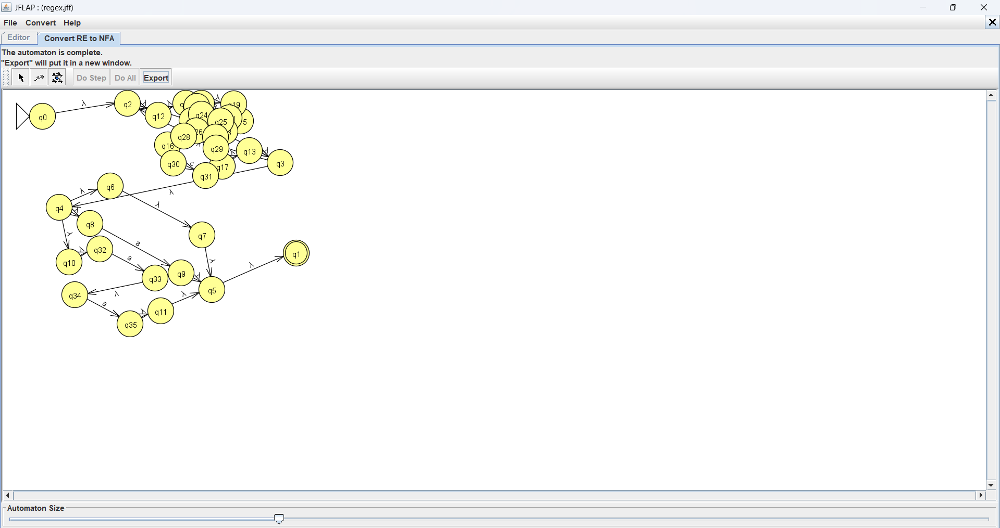

### Эквивалентный КА
Полученный НКА экспортирован в отдельное окно (Export).

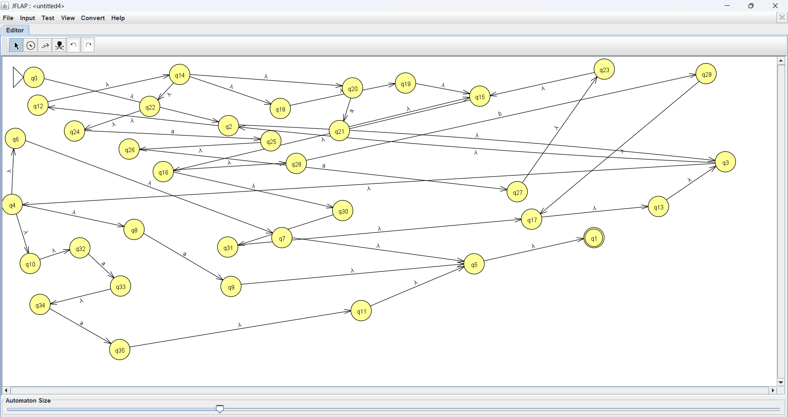

Проверка на наборе строк (Input → Multiple Run): строки `aabaa`, `cacaab`, `abacaab`, `bb`, λ допускаются; `aaa`, `baaab`, `caaaa` отвергаются.

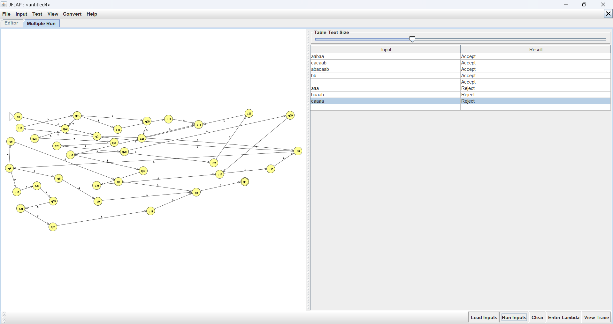

---

## Часть 2. Регулярная грамматика для L12

### Построение РГ
Будем порождать строку слева направо и помнить, сколько символов a подряд уже стоит в конце порожденной части. Для этого нужны три нетерминала:
* $S$ - в конце нет a (начало строки или последний символ b/c);
* $A$ - в конце ровно одна a;
* $B$ - в конце ровно две a.

Из любого нетерминала можно дописать b или c и вернуться в $S$. Символ a можно дописать только из $S$ (переход в $A$) и из $A$ (переход в $B$); у $B$ продукции с a нет, поэтому третья a подряд не порождается. Закончить строку можно в любой момент.

$G = (\{a,b,c\}, \{S, A, B\}, P, S)$, где $P$:

$$S \to aA \mid bS \mid cS \mid \lambda$$
$$A \to aB \mid bS \mid cS \mid \lambda$$
$$B \to bS \mid cS \mid \lambda$$

Все продукции имеют вид $X \to xY$ или $X \to \lambda$, значит грамматика праволинейная, т.е. регулярная.

Файл: `grammar.jff`.

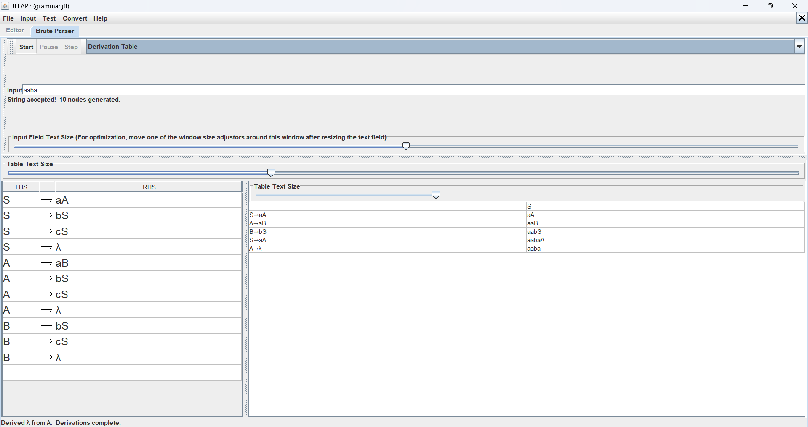

**Примеры выводов:**
* `aaba`: S ⇒ aA ⇒ aaB ⇒ aabS ⇒ aabaA ⇒ aaba
* `caab`: S ⇒ cS ⇒ caA ⇒ caaB ⇒ caabS ⇒ caab
* `aaa`: S ⇒ aA ⇒ aaB, дальше продукции с a нет, вывода не существует.

Проверка вывода `aaba` в JFLAP (Input → Brute Force Parse, вид Derivation Table):

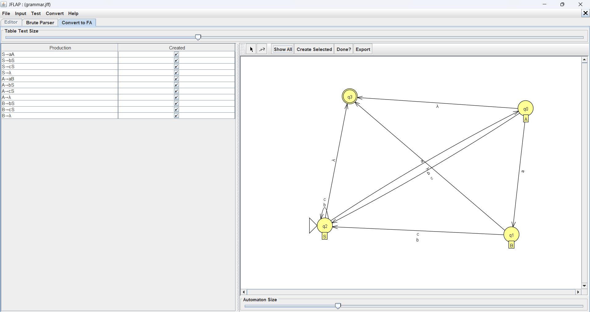

### Преобразование РГ → КА (Convert → Convert Right-Linear Grammar to FA)
По теореме 5.1 каждый нетерминал становится состоянием, начальное состояние соответствует $S$. Продукция $X \to xY$ дает дугу $X \to Y$ по символу $x$. Для продукций $X \to \lambda$ JFLAP создает отдельное заключительное состояние $V_f$ и λ-переходы в него. Номера состояний JFLAP присваивает сам: $S = q_2$, $A = q_0$, $B = q_1$, $V_f = q_3$.

| Продукция | Переход КА |
| :---: | :---: |
| $S \to aA$ | $q_2 \xrightarrow{a} q_0$ |
| $S \to bS \mid cS$ | $q_2 \xrightarrow{b,\,c} q_2$ |
| $S \to \lambda$ | $q_2 \xrightarrow{\lambda} q_3$ |
| $A \to aB$ | $q_0 \xrightarrow{a} q_1$ |
| $A \to bS \mid cS$ | $q_0 \xrightarrow{b,\,c} q_2$ |
| $A \to \lambda$ | $q_0 \xrightarrow{\lambda} q_3$ |
| $B \to bS \mid cS$ | $q_1 \xrightarrow{b,\,c} q_2$ |
| $B \to \lambda$ | $q_1 \xrightarrow{\lambda} q_3$ |

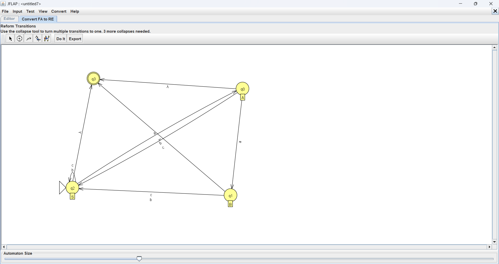

### Преобразование КА → РВ (Convert → Convert FA to RE)
Полученный КА экспортирован и преобразован в РВ методом исключения состояний (лекция 4).

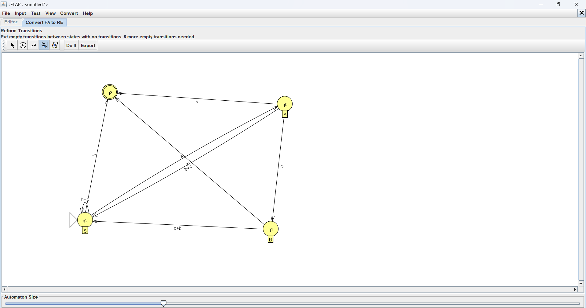

**Шаг 1. Единственное заключительное состояние.** У КА уже одно заключительное состояние $q_3$, и оно не совпадает с начальным $q_2$, поэтому новое состояние не требуется.

**Шаг 2. Слияние параллельных переходов (Transition Collapser).** Дуги по b и c сливаются в одну дугу `b+c`: петля $q_2 \to q_2$, а также $q_0 \to q_2$ и $q_1 \to q_2$.

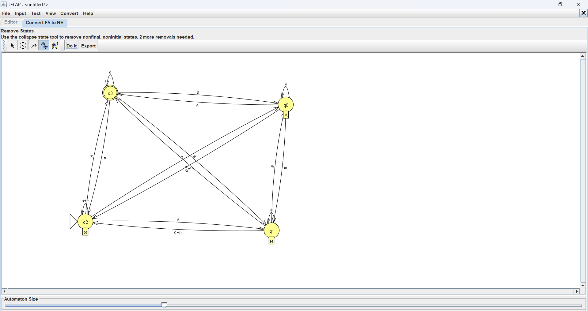

**Шаг 3. Пустые переходы.** Для пар состояний без дуги создаются ∅-переходы (8 штук): $q_2\to q_1$, $q_0\to q_0$, $q_1\to q_0$, $q_1\to q_1$, $q_3\to q_2$, $q_3\to q_0$, $q_3\to q_1$, $q_3\to q_3$. Получен обобщенный граф переходов. Матрица меток $r_{ij}$:

| из \ в | $q_2$ (S) | $q_0$ (A) | $q_1$ (B) | $q_3$ |
| :---: | :---: | :---: | :---: | :---: |
| $q_2$ (S) | b+c | a | ∅ | λ |
| $q_0$ (A) | b+c | ∅ | a | λ |
| $q_1$ (B) | b+c | ∅ | ∅ | λ |
| $q_3$ | ∅ | ∅ | ∅ | ∅ |

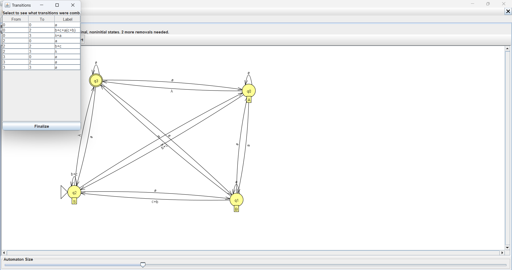

**Шаг 4. Исключение $q_1$ (State Collapser).** Формула $r_{ij} := r_{ij} + r_{i1}\, r_{11}^{*}\, r_{1j}$, где $r_{11}=\emptyset$, $\emptyset^*=\lambda$. В $q_1$ входит только дуга из $q_0$ (метка a), поэтому меняются только метки из $q_0$:
* $r_{02} = (b+c) + a(b+c)$
* $r_{03} = \lambda + a\lambda = \lambda + a$
* $r_{00} = \emptyset + a\,\emptyset = \emptyset$ (без изменений)

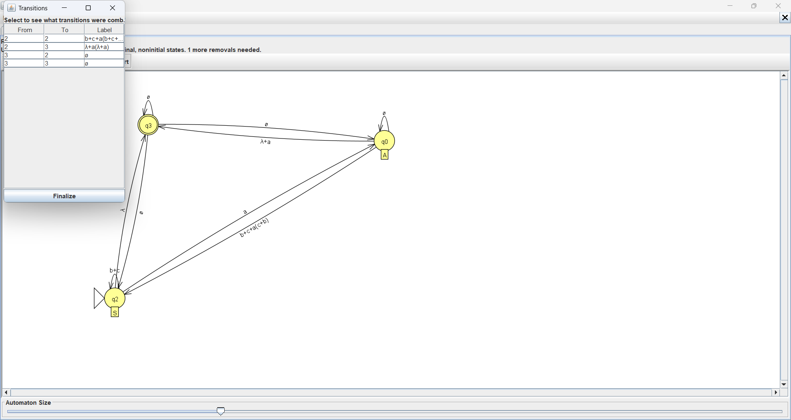

**Шаг 5. Исключение $q_0$.** В $q_0$ входит только дуга из $q_2$ (метка a), $r_{00}=\emptyset$:
* $r_{22} = (b+c) + a\big((b+c) + a(b+c)\big) = b+c+a(b+c)+aa(b+c)$
* $r_{23} = \lambda + a(\lambda + a) = \lambda+a+aa$

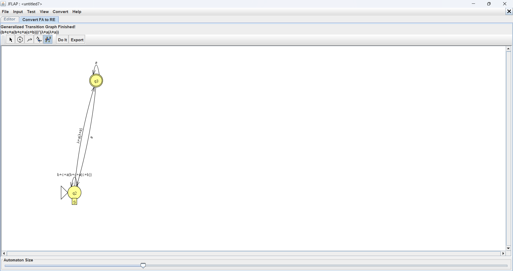
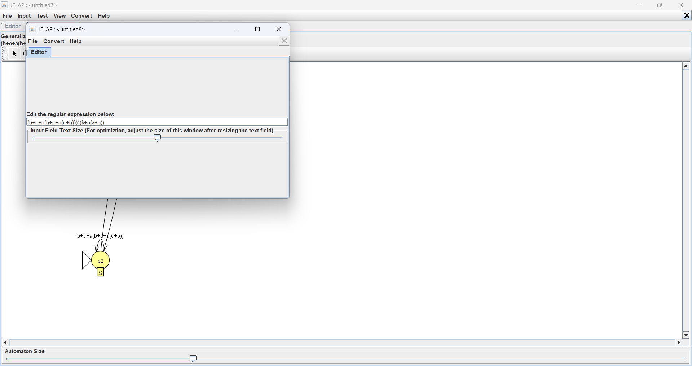

**Шаг 6. Итоговое РВ.** Остались $q_2$ (начальное) и $q_3$ (заключительное), $r_{32} = r_{33} = \emptyset$, поэтому формула $(r_{22}^* r_{23} r_{33}^* r_{32})^* r_{22}^* r_{23} r_{33}^*$ сводится к $r_{22}^*\, r_{23}$:

$$\big(b+c+a(b+c)+aa(b+c)\big)^*\,(\lambda+a+aa)$$


Вынеся $(b+c)$ за скобки, получаем $\big((\lambda+a+aa)(b+c)\big)^*(\lambda+a+aa)$, т.е. в точности РВ из части 1. Значит, РВ, РГ и оба КА задают один и тот же язык L12.

---

## Часть 3. Язык L38 = {a<sup>n</sup>ba<sup>n</sup> : n ≥ 1}

**Утверждение:** L38 не является регулярным.

**Доказательство (от противного, лемма о разрастании).**
1. Предположим, что L38 регулярен. Тогда по лемме существует константа $p \ge 1$ такая, что любая строка $w \in L38$, $|w| \ge p$, разбивается как $w = xyz$, где $y \ne \varepsilon$, $|xy| \le p$ и $xy^kz \in L38$ для всех $k \ge 0$.
2. Выберем $w = a^p b a^p$. Тогда $w \in L38$ (n = p ≥ 1) и $|w| = 2p + 1 \ge p$.
3. Рассмотрим **произвольное** разбиение $w = xyz$ с $|xy| \le p$, $y \ne \varepsilon$. Первые $p$ символов $w$ все равны a, поэтому $xy$ целиком лежит в первом блоке a: $x = a^s$, $y = a^t$, $z = a^{p-s-t} b a^p$, где $t \ge 1$, $s + t \le p$.
4. Возьмем $k = 0$: $xy^0z = xz = a^{p-t} b a^p$. Так как $t \ge 1$, число a слева $p - t$ не равно числу a справа $p$, значит $xz \notin L38$. (Для $k = 2$ аналогично: $a^{p+t} b a^p \notin L38$.)
5. Получено противоречие с пунктом 3 леммы. Следовательно, L38 не регулярен. ∎

Интуиция: чтобы проверить равенство числа a слева и справа, автомат должен «помнить» сколь угодно большое n, а у конечного автомата конечная память.

---

## Выводы
Для языка L12 построено регулярное выражение $((\lambda+a+aa)(b+c))^*(\lambda+a+aa)$ и по алгоритму из лекции 4 пошагово преобразовано в эквивалентный НКА. Для того же языка построена праволинейная грамматика, по теореме 5.1 преобразована в КА, а затем методом исключения состояний в РВ, совпадающее с РВ из части 1. С помощью леммы о разрастании доказано, что язык L38 = {a<sup>n</sup>ba<sup>n</sup>} не является регулярным.
